# 具身智能 AI Infra 文献总导读

## 阅读范围与约定

本导读覆盖当前目录中的 7 篇原始 PDF：

1. ALOHA / ACT；
2. Diffusion Policy；
3. Flow Matching；
4. RT-2；
5. OpenVLA；
6. π₀；
7. OpenVLA-OFT。

已有中文导读作为辅助材料，不重复作为独立论文分析。全文不做论文之间的横向排名，而是逐篇回答同一组 Infra 问题：数据怎样进入系统、模型怎样训练、动作怎样生成、推理怎样满足实时性、执行阶段有哪些延迟与失效边界。

引文使用英文原文，换行和连字只是为了排版而整理，关键措辞不改；页码均指本地 PDF 的物理页码。表格或图按原 PDF 的对应区域裁出，放在 [`assets/`](assets/) 中。缺省的部署细节不会被补写成论文结论。

### 图表裁切来源

| 文件 | 原 PDF 位置 | 内容 |
| --- | --- | --- |
| `aloha_act_architecture.png` | ALOHA，p. 4 | Fig. 4 ACT 架构；Fig. 5 动作块与时间集成 |
| `diffusion_overview.png` | Diffusion Policy，p. 3 | Figure 2 总览、预测视界和两种条件网络 |
| `diffusion_hyperparameters.png` | Diffusion Policy，p. 17 | Table 7/8 模型、视界和扩散步数 |
| `flow_training_sampling.png` | Flow Matching，p. 8 | Table 1 采样 NFE；Figure 6 路径对比 |
| `rt2_overview.png` | RT-2，p. 2 | Figure 1 动作 token 与共微调总览 |
| `openvla_architecture.png` | OpenVLA，p. 4 | Figure 2 模型架构与 7 维动作输出 |
| `openvla_quantization.png` | OpenVLA，p. 10 | Figure 6 推理速度；Table 2 量化显存与成功率 |
| `pi0_framework.png` | π₀，p. 4 | Figure 3 预训练、模型与部署框架 |
| `pi0_inference_table.png` | π₀，p. 16 | Table I 推理时间分解 |
| `oft_design_decisions.png` | OpenVLA-OFT，p. 3 | Fig. 2 解码策略和动作表示 |
| `oft_inference_table.png` | OpenVLA-OFT，p. 10 | Table III 真实 ALOHA 推理效率 |

## 统一的 Infra 分析框架

| 层次 | 本文关注的问题 |
| --- | --- |
| 数据面 | 数据量、采集频率、多相机同步、动作标签、异构机器人数据混合、预处理与存储。 |
| 训练面 | 模型规模、预训练/微调、批大小、GPU 数量、训练时长、显存与数据吞吐。 |
| 推理面 | 自回归或并行生成、扩散/flow 采样步数、KV 缓存、量化、吞吐、单请求延迟。 |
| 运行面 | 策略频率、动作块长度、执行视界、反馈周期、网络延迟、抖动和安全降级。 |

对机器人策略，尤其要区分三种“频率”：

- 相机采样频率；
- 策略生成一段动作的频率；
- 电机内部位置/速度/力矩环的频率。

论文报告的控制频率通常不是电机 PID 环频率，也不能直接等同于端到端推理吞吐。后文会在具体论文中说明其含义。

## 目录

- [1. ALOHA / ACT：低成本双臂系统的数据与动作块基线](#1-aloha--act低成本双臂系统的数据与动作块基线)
- [2. Diffusion Policy：多步去噪与滚动动作块](#2-diffusion-policy多步去噪与滚动动作块)
- [3. Flow Matching：训练与采样成本的生成模型基础](#3-flow-matching训练与采样成本的生成模型基础)
- [4. RT-2：云端大模型与动作 token](#4-rt-2云端大模型与动作-token)
- [5. OpenVLA：开放 VLA 的训练、部署与量化](#5-openvla开放-vla-的训练部署与量化)
- [6. π₀：跨机器人预训练与实时动作块推理](#6-π₀跨机器人预训练与实时动作块推理)
- [7. OpenVLA-OFT：并行解码与真实双臂部署](#7-openvla-oft并行解码与真实双臂部署)
- [8. Infra 复核清单与术语](#8-infra-复核清单与术语)

---

## 1. ALOHA / ACT：低成本双臂系统的数据与动作块基线

### 1.1 论文定位

**论文：** Tony Z. Zhao, Vikash Kumar, Sergey Levine, Chelsea Finn, *Learning Fine-Grained Bimanual Manipulation with Low-Cost Hardware*, arXiv:2304.13705。

**本地文件：** [Zhao 等原始 PDF](<../Zhao 等 - 2023 - Learning Fine-Grained Bimanual Manipulation with Low-Cost Hardware/Zhao 等 - 2023 - Learning Fine-Grained Bimanual Manipulation with Low-Cost Hardware.pdf>)

这篇论文同时构建了一台低成本双臂遥操作设备和 ACT 策略。对 AI Infra 来说，它提供了一个很小但完整的闭环：多路相机和机器人状态同步采集、单卡训练、单次前向生成动作块、以时间集成执行，并在 50 Hz 控制链路上运行。

### 1.2 原文关键段

动作标签为什么采用领导者机械臂，而不是跟随者机械臂：

> “We record the joint positions of the leader robots (i.e., input from the human operator) and use them as actions. It is important to use the leader joint positions instead of the follower’s, because the amount of force applied is implicitly defined by the difference between them, through the low-level PID controller. The observations are composed of the current joint positions of follower robots and the image feed from 4 cameras.”（PDF p. 4）

这里记录的是“期望目标关节位置”，不是直接记录力矩。底层位置伺服比较目标与跟随者当前关节位置，将跟踪误差转换为电机驱动；因此它是位置控制接口，而非显式力控接口。

动作块和时间集成的推理方式：

> “To improve the smoothness and avoid discrete switching between executing and observing, we query the policy at every timestep. This makes different action chunks overlap with each other, and at a given timestep there will be more than one predicted action.”（PDF p. 5）

<span style="color: orange;">每次预测一整段动作，但每个控制时刻仍可重新推理，然后对“不同预测块针对同一目标时刻”的动作做指数加权融合</span>。论文给出的合并形式是：

$$
a_t=\frac{\sum_i w_iA_t[i]}{\sum_iw_i},
\qquad w_i=e^{-mi}.
$$

训练和部署资源的原文口径：

> “The model has around 80M parameters, and we train from scratch for each task. The training takes around 5 hours on a single 11G RTX 2080 Ti GPU, and the inference time is around 0.01 seconds on the same machine.”（PDF p. 6）

数据规模的原文口径：

> “Each episode takes 8-14 seconds for the human operator to perform depending on the complexity of the task, which translates to 400-700 time steps given the control frequency of 50Hz. We record 50 demonstrations for each task, except for Thread Velcro which has 100.”（PDF p. 8）

### 1.3 原论文系统图

下图裁自 PDF p. 4，包含 ACT 的 CVAE 编码器/解码器结构，以及动作块与时间集成的执行示意。<span style="color: orange;">左半部分的 CVAE 编码器只在训练时使用，右半部分的解码器在训练时和编码器一起使用，测试时则单独保留成为实际策略</span>。

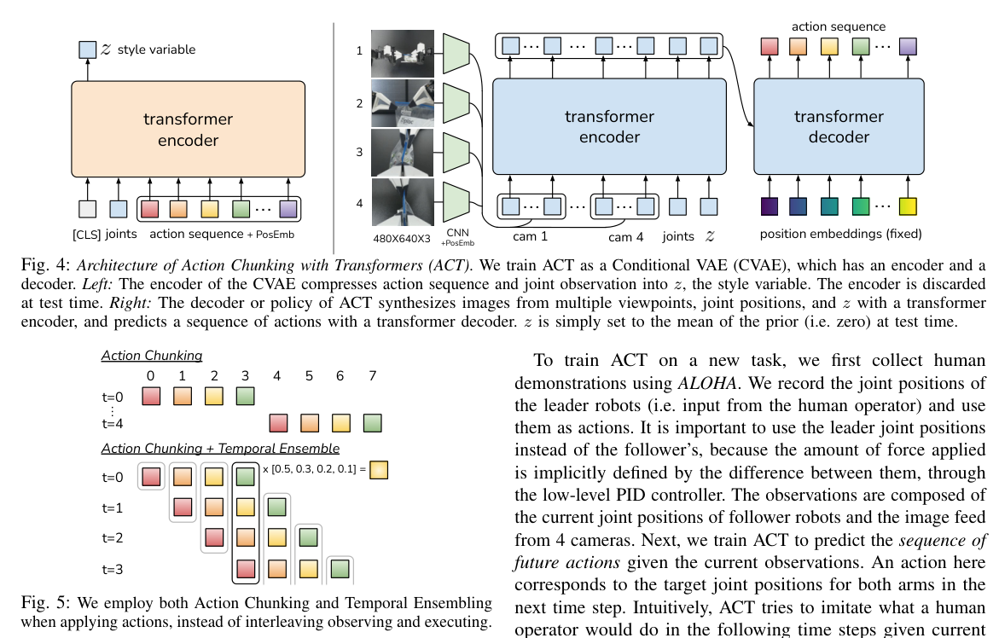

### 1.4 数据面

ALOHA 的一个训练样本由以下内容组成：

- 四路 RGB 图像：前视、顶视、左腕、右腕；
- 跟随者当前关节位置；
- 领导者未来 $k$ 个时间步的关节目标；
- 语言指令并非此基础系统的必需输入，任务身份隐含在每任务独立训练的策略中。

关键工程细节如下：

| 项目 | 原文信息及 Infra 含义 |
| --- | --- |
| 图像尺寸 | 每路 $480\times640\times3$。四路同时输入会产生较大的像素 I/O 和视觉编码成本。 |
| 相机流 | 每路约 30 fps；遥操作和数据记录为 50 Hz。两类频率不一致，实际系统必须进行时间戳对齐、重采样或帧复用；论文没有展开同步实现。 |
| 动作维度 | 双臂各 7 维，共 14 维绝对关节目标。 |
| 示范数量 | 每任务通常 50 条，Thread Velcro 为 100 条。 |
| 有效数据时长 | 每任务约 10–20 分钟；加入复位和失败重录后，真实采集墙钟时间为 30–60 分钟。 |
| 训练集合 | 每任务从零训练一个策略，没有跨任务共享参数。 |

从基础设施角度看，数据成本大于训练成本。单次训练只需一张 11 GB GPU、约 5 小时，但每条高质量示范都需要双臂硬件、人工操作、复位环境和成功筛选。后续要扩展系统，优先瓶颈会是多站点数据生产、时间对齐、动作维度统一和数据质量，而非单张 GPU 的算力。

### 1.5 训练面

ACT 使用条件 **VAE**<span style="color: orange;">（Variational Autoencoder，变分自编码器。普通自编码器一般是把输入压缩**编码**到一个隐变量，再从隐变量**解码**恢复输入，获得提炼后的输入，达到**提取特征/降维/去噪**的作用；**VAE** 则不是直接生成一个固定的隐向量，而是生成一个概率分布，然后从这个分布中采样隐变量，再由解码器重构输入。**训练目标主要有二**：解码器输出要接近原始输入；让隐变量分布接近标准正态分布）</span>。

<span style="color: orange;">另外，还有 CVAE（Conditional VAE，条件变分自编码器），解码的部分不只根据隐变量生成动作，而是还依赖当前观测条件（图像与机器人状态）：$
\text{观测 } o
+
\text{隐变量 } z
\longrightarrow
\text{动作块 } a
$。</span>

<span style="color: orange;">**训练**时，**编码器**接收动作块和本体状态，推断潜在变量 $z$；**解码器**以完整图像、本体状态和 $z$ 为条件输出动作块</span>。<span style="color: orange;">测试时丢弃编码器，并令 $z=0$（表示测试时没有参考答案）</span>，因此部署路径仍是确定性的单次前向。

图像经过 ResNet18 提取特征：

$$
480\times640\times3
\longrightarrow 15\times20\times512
\longrightarrow 300\times512.
$$

四路图像合并后是 $1200\times512$；再加入跟随者关节和 $z$，Transformer 编码器输入为 $1202\times512$。解码器用固定查询生成 $k\times512$，再经 MLP 输出 $k\times14$。

论文附录中的 ACT 超参数包括：

| 超参数 | 数值 |
| --- | --- |
| 学习率 | $10^{-5}$ |
| Batch size | 8 |
| Encoder / decoder 层数 | 4 / 7 |
| Feed-forward 维度 | 3200 |
| Hidden 维度 | 512 |
| Attention heads | 8 |
| 动作块长度 $k$ | 100 |
| CVAE 权重 $\beta$ | 10 |
| Dropout | 0.1 |

这里最值得 Infra 注意的是视觉 token 数量。1202 个 token 的 Transformer 编码带来近似二次的注意力成本；若增加相机、分辨率或输入历史，成本会明显上升。<span style="color: orange;">论文的四路相机全部送入一个长序列（一个样本会很大），简化了融合逻辑，但也限制了大 batch （大样本数）训练</span>。

### 1.6 推理与运行面

ACT 的推理路径可以拆成：

1. 采集并预处理四路图像和 14 维关节状态；
2. 每路图像经过 ResNet18；
3. 拼接图像 token、关节和 $z$，做 Transformer 编码；
4. 解码 100 步动作块；
5. 将当前时刻的多个重叠预测做时间集成；
6. 把 14 维目标关节位置交给底层伺服。

论文报告模型前向约 10 ms，支持按 50 Hz 查询策略。这里有几个部署边界需要特别注明：

- 10 ms 是模型前向口径，论文没有把相机采集、图像预处理、跨进程传输和时间集成全部拆开报告；
- 相机流约 30 fps，而控制与动作记录为 50 Hz，端到端观察并不是每个控制周期都有全新图像；
- 每个控制时刻重新推理会显著增加总算力需求，但可以通过重叠动作块获得更平滑的切换；
- 时间集成需要保存尚未执行完的动作预测，缓存大小随时间集成长度和动作块长度增长；
- 动作块内部没有重新观察，遇到突然扰动时，后半段动作主要依赖底层控制器和之前的预测。

这套架构很适合作为边缘侧设计参考：80M 参数、11 GB 显存即可训练，消费级 GPU 即可完成推理。真正的实时性风险来自多相机 I/O、Transformer 长序列、同步与端到端抖动，而不是模型参数本身。

<span style="color: orange;">Action Chunking 决定模型一次预测多少步；  
Temporal Ensemble 决定每一步执行时，如何处理不同时间、不同预测对同一个当前动作的意见。  
如果没有 Temporal Ensemble，那就是一次预测 k 步，然后依次执行，k 步执行完了再预测；用 Temporal Ensemble 之后，则是这样（设 k = 4）：</span>

1. $t=0$ 获取观测，预测 $a_0,a_1,a_2,a_3$，执行当前的 $a_0$。
2. $t=1$ 获取新观测，再预测 $b_1,b_2,b_3,b_4$。现在模型对当前要执行的动作有两个预测：旧块中的 $a_1$ 和新块中的 $b_1$，将它们加权平均后执行。
3. $t=2$ 再获取观测、重新预测；对时刻 2 的候选动作进行融合后执行。
4. 之后每个控制步重复这一流程。

<span style="color: orange;">**本人在这一步构思新的 idea**：  
让执行长度 k 随当前状态变化，动态寻求最优 k。</span>

一个可行的第一版方法是自适应执行长度：
1. 模型仍然一次预测最多 $K$ 步的动作块。
2. 每次只执行前 $r_t$ 步，其中 $1\le r_t\le K$。
3. 执行完 $r_t$ 步后获取新观测，再预测下一块。
4. 根据当前情况调整 $r_t$：动作预测越不确定、越接近接触或精细操作、环境变化越明显，就缩短执行长度；运动稳定、预测一致、推理资源紧张时，则适当加长。

<span style="color: orange;">有一个有相似性的可参考论文</span>：https://openaccess.thecvf.com/content/CVPR2026/papers/Liang_Adaptive_Action_Chunking_at_Inference-time_for_Vision-Language-Action_Models_CVPR_2026_paper.pdf?utm_source=openai

### 1.7 资源与失效边界

论文附录报告了两个未能可靠学习的任务：拆糖纸和平放小自封袋。失败与透明/可变形物体感知、低对比、抓取位置导致的形变差异有关。对系统设计而言，这说明：

- 增加相机并不自动解决视觉歧义；
- 固定动作块在执行早期抓取失败后，未必具备重新尝试行为；
- 任务专用策略没有跨任务回退机制；
- 高精度依赖相机、夹具、接触条件和底层控制器的联合稳定性。

论文还明确说明硬件受平行夹爪、低扭矩和多指操作能力限制。多传感器、更大模型或更长上下文都不能单独绕过这些物理边界。

### 1.8 这篇论文给出的 Infra 要点

1. **单卡可训练、单卡可推理的最小闭环。** 80M 参数、四路相机和 50 Hz 控制足以形成端到端系统，是很好的 profiling 与数据管线基线。
2. **动作块是计算摊销机制。** 一次前向生成 100 步动作，降低策略调用频率；时间集成则用额外推理换平滑性和反馈能力。
3. **数据生产是首要成本。** 高质量双臂示范包含硬件、人工、复位和失败重录，不能只用训练 GPU 小时衡量。
4. **“控制频率”必须拆分。** 50 Hz 是系统遥操作/记录口径，不等于四路相机每帧都新、也不等于模型每个控制周期都完成全部预处理。

---

## 2. Diffusion Policy：多步去噪与滚动动作块

### 2.1 论文定位

**论文：** Cheng Chi, Zhenjia Xu, et al., *Diffusion Policy: Visuomotor Policy Learning via Action Diffusion*, arXiv:2303.04137v5。

**本地文件：** [Chi 等原始 PDF](<../Chi 等 - 2024 - Diffusion Policy Visuomotor Policy Learning via Action Diffusion/Chi 等 - 2024 - Diffusion Policy Visuomotor Policy Learning via Action Diffusion.pdf>)

这篇论文将视觉运动策略表示成动作序列上的条件去噪过程。对 Infra 而言，它展示了一种典型的“观测编码一次、动作迭代生成多次”的服务路径，并通过预测动作块来摊销扩散推理成本。

### 2.2 原文关键段

动作序列和闭环执行的定义：

> “Concretely, at time step t the policy takes the latest To steps of observation data Ot as input and predicts Tp steps of actions, of which Ta steps of actions are executed on the robot without re-planning. Here, we define To as the observation horizon, Tp as the action prediction horizon and Ta as the action execution horizon. This encourages temporal action consistency while remaining responsive.”（PDF p. 3）

只对动作去噪、不让图像参与去噪的收益：

> “The exclusion of observation features Ot from the output of the denoising process significantly improves inference speed and better accommodates real-time control. It also helps to make end-to-end training of the vision encoder feasible.”（PDF p. 3）

DDIM 降低推理步数：

> “In our real-world experiments, using DDIM with 100 training iterations and 10 inference iterations enables 0.1s inference latency on a Nvidia 3080 GPU.”（PDF p. 4）

作者对计算成本的直接承认：

> “Second, diffusion policy has higher computational costs and inference latency compared to simpler methods like LSTM-GMM. Our action sequence prediction approach partially mitigates this issue, but may not suffice for tasks requiring high rate control.”（PDF p. 13）

### 2.3 原论文系统图

下图裁自 PDF p. 3，展示观测序列、动作序列、预测视界 $T_p$，以及 CNN 和 Transformer 两种条件注入方式。

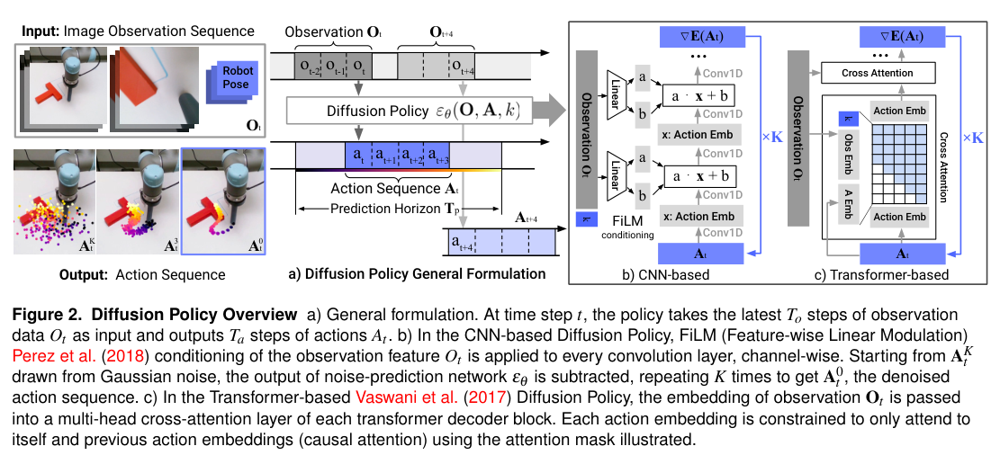

### 2.4 核心计算路径

设当前观测为 $O_t$，干净动作块为 $A_t^0$，扩散步为 $k$。训练时向动作加入噪声，让网络预测噪声：

$$
\mathcal L
=\operatorname{MSE}\left(
\epsilon_k,
\epsilon_\theta(O_t,A_t^0+\epsilon_k,k)
\right).
$$

推理时从高斯噪声 $A_t^K$ 开始，执行 $K$ 次条件去噪：

$$
A_t^{k-1}
=\alpha\left(
A_t^k-\gamma\epsilon_\theta(O_t,A_t^k,k)
+\mathcal N(0,\sigma^2I)
\right).
$$

视觉编码只依赖 $O_t$，与扩散步 $k$ 无关。因此实现上可以：

1. 编码所有相机；
2. 缓存观测特征；
3. 对每个去噪步只运行动作网络；
4. 输出整段动作，再由运行时模块执行 $T_a$ 步。

这正对应现代生成式推理系统里的“条件 prefill 一次、生成步骤复用条件表示”。论文没有使用这一 LLM 术语，但计算结构相同。

### 2.5 训练与超参数

PDF p. 17 的 Table 7 给出了 CNN 版本的关键资源参数，包括动作维度、观察视界、执行视界、预测视界、图像分辨率、模型参数、训练/推理扩散步数和学习率。

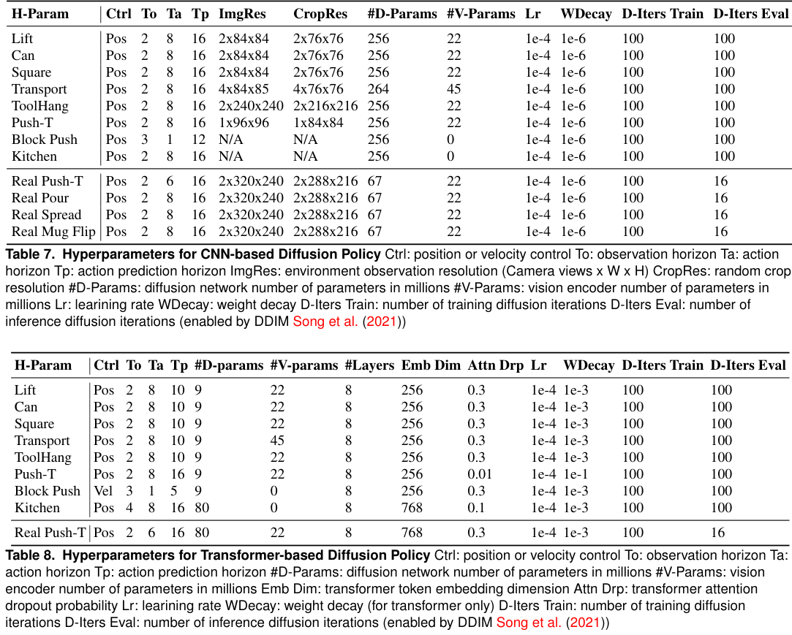

主要资源信息可总结为：

| 项目 | 论文配置 |
| --- | --- |
| 常用观察视界 | $T_o=2$ |
| 常用预测视界 | $T_p=16$ |
| 常用执行视界 | $T_a=8$；真实 Push-T 为 6 |
| 图像输入 | 多数仿真任务 2 路 $84\times84$；真实任务 2 路 $320\times240$ |
| CNN 扩散网络参数 | 仿真约 256M，真实 Push-T 约 67M |
| 视觉编码器参数 | 约 22M |
| 图像任务 batch size | 64 |
| 状态任务 batch size | 256 |
| 仿真扩散步数 | 训练和推理均 100 |
| 真实任务推理步数 | 附录表和实现细节写为 16 |

论文正文举例一处写“10 个推理步、0.1 秒”，附录 Table 7 与 A.4 节写真实实验使用 16 个推理步。引用固定推理成本时应以具体任务和配置为准，并注意正文与附录的这处不一致。

### 2.6 数据面与视觉编码

每个相机使用独立 ResNet18，每个时间步独立编码，再将各相机特征拼接。ResNet18 从零训练，使用空间 softmax 池化保留位置信息，并用 GroupNorm 替代 BatchNorm，以便与 DDPM 常用的指数滑动平均配合。

从 Infra 看，这里有三个成本来源：

- **多相机 I/O 和预处理。** 每个观测视界都要读取和归一化多张图像。
- **视觉编码。** 虽然只编码一次，但不同相机使用独立编码器，参数和计算量随相机数增加。
- **动作生成。** 去噪网络只处理动作序列，因此动作维度低，迭代成本通常小于视觉主干。

论文发现输入分辨率对精度有影响，但没有给出统一的吞吐-分辨率曲线；实际部署应单独测量相机采集、 resize、编码和去噪各段延迟。

### 2.7 推理与运行面

CNN 和 Transformer 两条路线的资源特征不同：

- CNN 用一维时间卷积，FiLM 注入观测和去噪步，通常更容易调参；
- Transformer 把带噪动作当 token，通过交叉注意力读取观测，在快速变化动作上表现更好，但更依赖学习率、dropout 和权重衰减；
- 两者都以整段动作序列为输出，执行时只取前 $T_a$ 步。

滚动时域把长轨迹拆成重复的“预测—执行—重规划”周期。论文报告位置控制在最多 4 个控制步的模拟延迟下仍接近峰值，但这是特定任务和控制器条件下的消融，不代表任意网络延迟都可容忍。

部署时最需要测量的是：

1. 从相机曝光到特征可用的延迟；
2. 一次扩散生成的全部去噪步耗时；
3. 执行动作块与后台生成下一块的并行能力；
4. 推理超时时是否继续执行剩余动作、重复上一次预测或安全停止。

论文描述了动作块的 rolling-horizon 结构，但没有给出多机器人并发服务、batching、preemption 或 p99 延迟设计。

### 2.8 失效边界与 Infra 结论

方法仍属于行为克隆，主要受示范数据分布限制。扩散多步采样比 LSTM-GMM 等单次回归更重；动作块能摊销这部分开销，但会增加执行阶段的“旧动作”比例。

对 AI Infra，这篇论文的直接价值是：

- 识别条件编码与动作生成的计算分离；
- 用动作块把高频控制转换为较低频的模型服务；
- 把生成步数、动作预测视界和执行视界作为可调资源参数；
- 将端到端延迟视为系统指标，而不是单个 GPU kernel 指标。

---

## 3. Flow Matching：训练与采样成本的生成模型基础

### 3.1 论文定位

**论文：** Yaron Lipman, Ricky T. Q. Chen, Heli Ben-Hamu, Maximilian Nickel, Matt Le, *Flow Matching for Generative Modeling*, arXiv:2210.02747。

**本地文件：** [Lipman 等原始 PDF](<../Lipman 等 - 2023 - Flow Matching for Generative Modeling/Lipman 等 - 2023 - Flow Matching for Generative Modeling.pdf>)

这篇论文不是机器人控制论文，也不包含机器人硬件或闭环执行。它研究如何训练连续归一化流（CNF），使模型能够从简单噪声沿学到的向量场变换到数据分布。对具身 AI Infra 的价值在于：它给出了训练时不需要反复模拟 ODE、推理时却需要数值积分的一类生成系统的资源模型。

### 3.2 原文关键段

论文对方法范围的概括：

> “We introduce a new paradigm for generative modeling built on Continuous Normalizing Flows (CNFs), allowing us to train CNFs at unprecedented scale. Specifically, we present the notion of Flow Matching (FM), a simulation-free approach for training CNFs based on regressing vector fields of fixed conditional probability paths.”（PDF p. 1）

Flow Matching 和条件 Flow Matching 的关系：

> “The FM (equation 5) and CFM (equation 9) objectives have identical gradients w.r.t. θ.”（PDF p. 4）

> “That is, optimizing the CFM objective is equivalent (in expectation) to optimizing the FM objective. Consequently, this allows us to train a CNF with a simple and efficient simulation-free training objective.”（PDF p. 4）

推理时为什么仍然需要数值积分：

> “For sampling, we first draw a random noise sample x0 ∼ N(0, I) then compute φ1(x0) by solving equation 1 with the trained VF, vt, on the interval t ∈ [0, 1] using an ODE solver.”（PDF p. 8）

最优传输路径对采样成本的影响：

> “When compared to our ablation models, we find that models trained using Flow Matching with the OT path always result in the most efficient sampler, regardless of ODE solver...” （PDF p. 9）

> “...the FM with OT model produces the best numerical error, in terms of computational cost, requiring roughly only 60% of the NFEs to reach the same error threshold as diffusion models.”（PDF p. 9）

### 3.3 原论文表格与路径可视化

下图裁自 PDF p. 8，包含 Table 1 和 Figure 6。Table 1 的 NFE 是函数评估次数，是采样计算量的核心指标；Figure 6 展示不同概率路径下样本从噪声走向目标的过程。

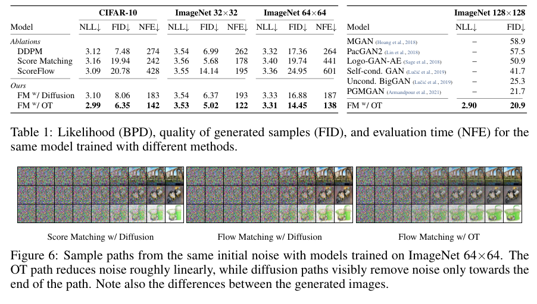

原表中原样列出的若干 NFE 指标如下：

| 训练目标 | CIFAR-10 NFE | ImageNet 32 NFE | ImageNet 64 NFE |
| --- | ---: | ---: | ---: |
| DDPM | 274 | 262 | 264 |
| Score Matching | 242 | 178 | 441 |
| Score Flow | 428 | 195 | 601 |
| FM w/ Diffusion | 183 | 193 | 187 |
| FM w/ OT | 142 | 122 | 138 |

这些 NFE 是平均函数评估次数，不是固定步数，也不是端到端生产延迟。不同模型、求解器、容差和样本分布之间不能直接做工程结论；但表清楚揭示了采样阶段的主要成本项。

### 3.4 数学结构

论文先定义目标概率路径 $p_t(x)$ 和相应向量场 $u_t(x)$，并希望网络 $v_t(x)$ 匹配它：

$$
\mathcal L_{\mathrm{FM}}(\theta)
=\mathbb E_{t,p_t(x)}
\left[\left\|v_t(x)-u_t(x)\right\|^2\right].
$$

普通 FM 目标需要知道边缘向量场 $u_t(x)$，在训练时不可直接计算。论文转而使用条件概率路径，优化：

$$
\mathcal L_{\mathrm{CFM}}(\theta)
=\mathbb E_{t,q(x_1),p_t(x\mid x_1)}
\left[\left\|v_t(x)-u_t(x\mid x_1)\right\|^2\right].
$$

论文证明在期望意义下，CFM 与 FM 具有相同梯度。因此训练时可以采样数据点、时间 $t$ 和条件路径上的样本，直接做向量场回归，不需要在训练循环内对 ODE 做完整数值模拟。

推理时则相反：从 $x_0\sim\mathcal N(0,I)$ 开始，沿 $v_t$ 积分到 $t=1$。即使训练是 simulation-free，部署仍要支付数值积分成本。

### 3.5 训练系统资源

论文附录 Table 3 给出了不同图像分辨率下的训练资源，这些数字很适合理解生成模型的训练规模：

| 数据集/分辨率 | GPU 数 | 有效 batch | 训练迭代 | 数值精度 |
| --- | ---: | ---: | ---: | --- |
| CIFAR-10 | 2 | 256 | 391K | 32-bit |
| ImageNet 32×32 | 4 | 1024 | 250K | 32-bit |
| ImageNet 64×64 | 16 | 2048 | 157K | 16-bit mixed |
| ImageNet 128×128 | 32 | 1536 | 500K | 16-bit mixed |

从资源模型看：

- 训练期的主要成本是向量场网络的 batch 前向/反向和优化器状态；
- 推理期的主要成本是 ODE 右端函数的重复调用；
- 更高分辨率会同时增加模型输入尺寸、激活内存和每次 NFE 的成本；
- 混合精度可以减少显存和计算时间，但论文没有报告吞吐、通信开销和失败重试。

由于训练目标只需要随机时间和随机样本，数据加载器需要能够高效生成连续时间批次，并将图像张量保持在适合 GPU 的类型和形状。论文报告的是研究环境中的训练配置，不是分布式训练调度或检查点恢复实现。

### 3.6 推理面的质量—NFE 权衡

论文的核心 Infra 结论不是“Flow Matching 一定更快”，而是“概率路径和数值求解器共同决定采样质量—成本曲线”。在相同容差下，FM with OT 使用了更少的 NFE；在固定 NFE 下，它也能保持更好的误差和样本质量。

实际服务时需要区分：

1. **自适应求解器。** 按误差容差自动选择步数，单样本 NFE 可能变化，导致请求级延迟不均。
2. **固定步求解器。** 延迟更可预测，适合硬实时系统，但质量依赖步数和步长。
3. **批次大小。** 增大 batch 改善 GPU 利用率，但会放大排队等待和峰值显存。
4. **数值精度。** 论文的图像实验使用了部分 16-bit mixed precision；具身应用还需验证动作输出误差对控制的放大效应。

### 3.7 边界

论文的实验对象是 CIFAR-10、ImageNet 和条件图像生成，不是机器人轨迹或闭环控制。它没有提供：

- 机器人动作张量的延迟/成功率曲线；
- 在线控制中的端到端 p99 延迟；
- 不同 batch 下的显存与吞吐曲线；
- 机器人硬件或低层控制器。

因此，这篇论文应作为理解 flow matching 训练目标和采样预算的基础，而不是直接当作机器人策略部署方案。若要把其结论用于动作生成，需要单独测量动作维度、动作块长度、ODE 步数和服务并发。

### 3.8 对 Infra 的直接启发

- 区分**训练 simulation-free**与**推理 ODE 采样**，前者减少训练循环依赖，后者仍消耗大量函数评估。
- 把 NFE、求解器类型和容差作为可观测的服务参数，单独报告每个请求的采样步数。
- 评估动作生成时，用动作误差和对下游控制稳定性的影响替代图像 FID 作为业务指标。

---

## 4. RT-2：云端大模型与动作 token

### 4.1 论文定位

**论文：** Anthony Brohan, Noah Brown, et al., *RT-2: Vision-Language-Action Models Transfer Web Knowledge to Robotic Control*, arXiv:2307.15818v1。

**本地文件：** [Brohan 等原始 PDF](<../Brohan 等 - 2023 - RT-2 Vision-Language-Action Models Transfer Web Knowledge to Robotic Control/Brohan 等 - 2023 - RT-2 Vision-Language-Action Models Transfer Web Knowledge to Robotic Control.pdf>)

RT-2 将机器人动作转换成语言模型词表中的 token，并让视觉语言模型直接输出低层动作。它最突出的 Infra 特征是把数十亿参数模型放到云端多 TPU 服务中，再通过网络为机器人提供动作预测。

### 4.2 原文关键段

动作 token 的格式：

> “In order to define a target for VLM fine-tuning we convert the action vector into a single string by simply concatenating action tokens for each dimension with a space character: ‘terminate Δposx Δposy Δposz Δrotx Δroty Δrotz gripper_extension’.”（PDF p. 6）

> “A possible instantiation of such a target could be: ‘1 128 91 241 5 101 127’.”（PDF p. 6）

机器人数据与网页视觉语言数据共同训练：

> “A key technical detail of the training recipe that improves robot performance is co-fine-tuning robotics data with the original web data instead of naïve finetuning on robot data only.”（PDF p. 6）

分布式云端推理的服务形态：

> “We develop a protocol that allows us to run RT-2 models on robots by deploying them in a multi-TPU cloud service and querying this service over the network. With this solution, we can achieve a suitable frequency of control and also serve multiple robots using the same cloud service.”（PDF p. 6）

原文给出的模型规模和控制频率：

> “The largest model trained in this work uses 55B parameters. It is infeasible to directly run such models on the standard desktop-style machines or on-robot GPUs commonly used for real-time robot control.”（PDF p. 6）

> “The largest model we evaluated, the 55B parameter RT-2-PaLI-X-55B model, can run at a frequency of 1-3 Hz. The smaller version of that model, consisting of 5B parameters, can run at a frequency of around 5 Hz.”（PDF p. 6）

作者对实时瓶颈的判断：

> “Second, although we showed we could run large VLA models in real time, the computation cost of these models is high, and as these methods are applied to settings that demand high-frequency control, real-time inference may become a major bottleneck.”（PDF p. 11）

### 4.3 原论文总览图

下图裁自 PDF p. 2，将视觉问答、机器人动作 token、共微调和闭环控制画在同一条数据流上。

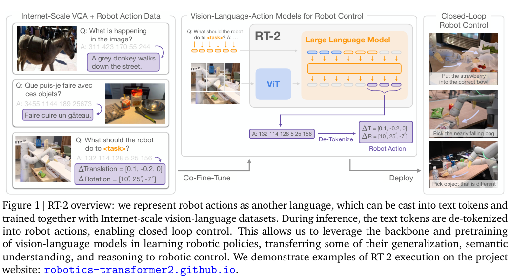

### 4.4 数据面

RT-2 的训练输入不只是机器人轨迹，还包括互联网规模的视觉语言任务。机器人动作被映射为离散 token，与文本 token 统一放入模型的输出序列。

动作维度包括：

- 末端执行器三维平移变化；
- 三维旋转变化；
- 夹爪开合程度；
- 终止信号。

每个连续动作维度分箱后对应一个离散 token。对 PaLI-X，整数 token 可直接承载分箱编号；对 PaLM-E，则覆盖词表中最少使用的 256 个 token 作为动作词表。这一设计将控制问题改造成“生成合法 token 字符串”的推理问题。

对数据管线的影响：

1. 动作标准化和分箱必须在机器人本体或数据预处理阶段完成；
2. 机器人轨迹要和网页 VQA 数据一起进入共微调混批；
3. 每个训练 batch 需要调节机器人数据和网页数据的采样比例，否则机器人数据可能被大规模网页数据淹没；
4. 推理时必须约束输出词表，避免生成无法反序列化的动作字符串。

### 4.5 训练面

论文训练了 PaLI-X 5B/55B、PaLI 3B 和 PaLM-E 12B 等规模。它不是单纯在机器人数据上微调，而是使用 robot trajectories 与原始视觉语言数据的共微调，以保留网页预训练中的语义和视觉知识。

从 Infra 视角看，主要资源压力在：

- 模型参数与优化器状态；
- 超大视觉语言模型的激活；
- 通用网页数据与机器人数据的混合采样；
- 多 TPU 训练的分片和同步；
- 词表覆盖/替换后，检查点与 tokenizer 的版本一致性。

论文没有在正文给出完整训练 GPU/TPU-hours、总样本量和全部通信开销，因此不能仅凭模型参数量估算端到端训练成本。

### 4.6 推理面：云端服务与动作 token 生成

RT-2 的推理链路是：

1. 机器人端采集图像与任务文本；
2. 通过 HTTP/RPC 等网络请求发送到云端；
3. 多 TPU 服务运行 VLM；
4. 模型按 token 生成动作字符串；
5. 机器人端解析、反归一化并执行动作；
6. 下一控制周期再次请求。

这种部署把显存和算力集中在云端，适合多个机器人共享大模型；但它引入了新的实时性变量：

- 网络往返时间；
- 请求排队与多机器人争抢；
- 多 TPU 推理的内部通信；
- token-by-token 串行解码；
- 机器人端动作缓存的正确性；
- 断网、超时和模型版本切换时的安全策略。

RT-2 报告 55B 模型约 1–3 Hz、5B 模型约 5 Hz。这里的 Hz 是从发出请求到得到动作的闭环服务频率口径，不等同于底层电机频率。论文说明云端可以服务多个机器人，但没有报告不同并发数下的 p50/p99 延迟和吞吐曲线；这对真实集群部署是重要缺口。

### 4.7 运行面与安全边界

低控制频率意味着机器人必须依赖动作保持、控制器反馈或专门的低层环路来填补模型调用之间的空档。论文对动作 token 的输出词表做了约束，保证可执行性，但没有展开：

- 推理超时后的动作保持时长；
- 多机器人批处理是否会导致某个机器人饿死；
- 网络抖动下的动作去重与时间戳校验；
- 云服务不可用时的本地 fallback；
- 动作 token 反量化误差对精细接触的影响。

### 4.8 失效边界与 Infra 结论

论文明确指出，网络规模预训练带来语义和视觉泛化，但机器人不会因此自动获得新的物理动作技能；物理技能仍受机器人数据分布限制。模型越大越能泛化，但也让推理成本更高。

对 Infra，RT-2 的可借鉴点是：

- 把动作表示纳入模型词表/输出契约，形成可版本化的推理 API；
- 用集中式大模型服务服务多机器人，而不是强行把 55B 模型放到机器人上；
- 把动作 token 生成速度、网络延迟和并发队列作为一级指标；
- 在模型服务之外单独设计低层控制器和故障安全策略。

---

## 5. OpenVLA：开放 VLA 的训练、部署与量化

### 5.1 论文定位

**论文：** Moo Jin Kim, Karl Pertsch, et al., *OpenVLA: An Open-Source Vision-Language-Action Model*, arXiv:2406.09246v3（本地 PDF 为 arXiv 版本）。

**本地文件：** [Kim 等 OpenVLA 原始 PDF](<../Kim 等 - 2024 - OpenVLA An Open-Source Vision-Language-Action Model/Kim 等 - 2024 - OpenVLA An Open-Source Vision-Language-Action Model.pdf>)

OpenVLA 把 VLA 的训练、推理和代码库开放出来。对 AI Infra，它比单纯的模型结构论文更像一个可运行的工程基线：给出数据规模、训练集群、显存、吞吐、量化、LoRA 和远程推理服务。

### 5.2 原文关键段

模型和动作输出：

> “OpenVLA builds on a Llama 2 language model combined with a visual encoder that fuses pretrained features from DINOv2 and SigLIP.”（PDF p. 1）

> “Given an image observation and a language instruction, the model predicts 7-dimensional robot control actions.”（PDF p. 4）

动作离散化：

> “Following Brohan et al. [7], we discretize each dimension of the robot actions separately into one of 256 bins. For each action dimension, we set the bin width to uniformly divide the interval between the 1st and 99th quantile of the actions in the training data.”（PDF p. 5）

训练与推理资源的原文：

> “The final OpenVLA model is trained on a cluster of 64 A100 GPUs for 14 days, or a total of 21,500 A100-hours, using a batch size of 2048. During inference, OpenVLA requires 15GB of GPU memory when loaded in bfloat16 precision (i.e., without quantization) and runs at approximately 6Hz on one NVIDIA RTX 4090 GPU...” （PDF p. 6）

远程推理服务：

> “For convenience, we implement a remote VLA inference server to allow real-time remote streaming of action predictions to the robot – removing the requirement of having access to a powerful local compute device to control the robot.”（PDF p. 6）

图像分辨率与训练计算：

> “We compared VLAs with 224 × 224px and 384 × 384px inputs, but found no performance difference in our evaluations, while the latter takes 3x longer to train.”（PDF p. 6）

### 5.3 原论文架构图

下图裁自 PDF p. 4：DINOv2/SigLIP 视觉特征经投影进入 Llama 2 7B，再由动作反 tokenizer 还原为 7 维动作。

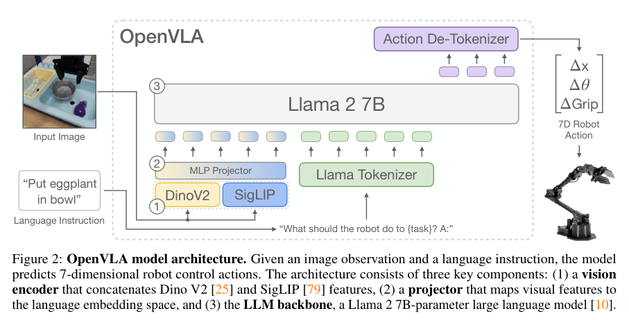

### 5.4 数据面

OpenVLA 使用约 970k 个真实机器人 episode，主要来自 Open X-Embodiment。训练数据的筛选和混合包含：

- 至少一个第三人称相机的单臂操作数据；
- Octo 的启发式数据混合权重；
- DROID 等新数据；
- 对任务和机器人组合的多样化采样。

动作空间是 7 维：三维位置、三维姿态和夹爪。每一维从训练数据 1%–99% 分位区间线性划分为 256 个 bin，这样可避免极端值扩大量化区间。对 Infra 来说，这意味着：

1. 动作归一化参数必须随数据集和机器人版本保存；
2. 训练和推理的分箱边界必须一致，否则同一个 token 会对应不同的物理动作；
3. 动作 token 与语言 token 共享词表/位置，模型 checkpoint 和 tokenizer 不能独立替换；
4. 数据过滤会直接影响可训练机器人和动作空间覆盖范围。

### 5.5 训练面

最终预训练配置：

| 资源项 | 论文数值/做法 |
| --- | --- |
| 模型 | 7B 参数 VLA，视觉特征来自 DINOv2 + SigLIP |
| 数据 | 约 970k robot episodes |
| 训练硬件 | 64 张 A100，14 天，约 21,500 A100-hours |
| Batch size | 2048 |
| 图像输入 | 224×224 |
| 训练目标 | 仅对动作 token 计算 next-token cross-entropy |
| 训练轮数 | 最终对数据集训练 27 个 epoch |

分辨率消融很有工程价值：384×384 使视觉 patch token 数增加，Transformer 训练计算近似按上下文长度二次增长，实际训练时间约为 224×224 的 3 倍，但论文评测中未观察到更好性能。这是“更高分辨率并不自动等于更高控制价值”的典型案例。

全参数微调与参数高效微调的对比：

- 全参数微调在每个任务上使用 8 张 A100，约 5–15 小时；
- LoRA 只训练约 1.4% 参数，即可达到接近全参数微调的平均表现；
- LoRA rank 32 的训练参数约 97.6M，batch 16 时显存约 59.7 GB；
- 论文报告 LoRA 将单任务微调降到单张 A100 的 10–15 小时，约 8 倍计算缩减。

### 5.6 推理与量化

OpenVLA 默认用 bf16 推理，7B 模型约占 15 GB 显存。论文在 RTX 4090 上未开启编译、推测解码等优化时约 6 Hz。随后测试了：

| 精度 | 显存 | Bridge 成功率 |
| --- | ---: | ---: |
| bf16 | 16.8 GB | 71.3% |
| int8 | 10.2 GB | 58.1% |
| int4 | 7.0 GB | 71.9% |

下图裁自 PDF p. 10，包含量化显存/成功率和不同 GPU 的推理速度对比。

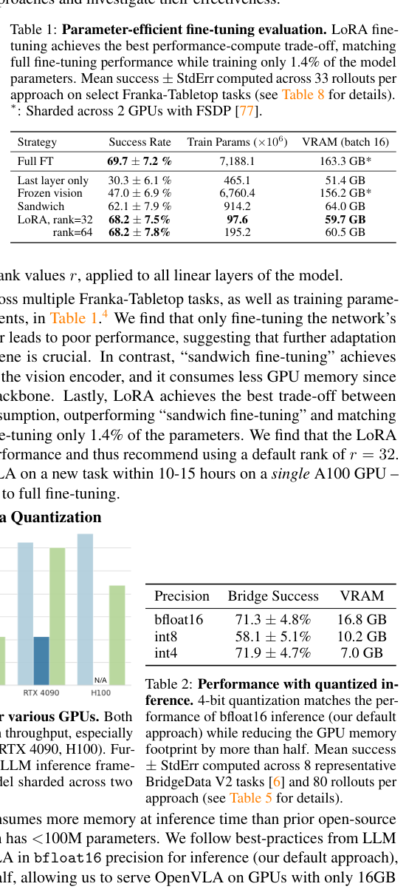

这组结果说明：

- 4-bit 量化可将显存压到约 7 GB，且在该论文的评测中保持 bf16 相近的成功率；
- int8 在该实验中并未带来同等收益，精度表现反而下降；
- 吞吐与成功率需要联合评估，不能只报告模型压缩率；
- 远程 VLA server 把计算从机器人本体移出，但也引入网络、串行化和多用户服务问题。

### 5.7 运行面

OpenVLA 的主训练配置是单第三人称相机、单臂末端执行器控制。这个接口与多相机双臂关节控制存在明显差异：

- 输入相机数少，视觉 patch 和上下文更短；
- 动作是相对末端执行器增量，不需要直接输出 14 维双臂关节；
- 自回归动作 token 存在串行依赖；
- 6 Hz 推理对低频操作可用，但对高频接触控制不足。

论文的远程推理服务是一个实际部署组件，但正文没有报告：

- 多机器人并发下的排队延迟；
- 网络 p50/p99 和重试策略；
- 推理服务不可用时的安全动作；
- 动态 batching 是否改变动作时序；
- 模型版本升级时 tokenizer 与动作归一化的一致性管理。

### 5.8 Infra 重点结论

1. **开放 VLA 的最小工程闭环。** 数据混合、训练、LoRA、量化和远程推理都在同一论文中给出，适合做可复现基线。
2. **视觉分辨率是训练吞吐的主导变量之一。** 更高分辨率增加 token 数和注意力成本，但未必提高机器人控制效果。
3. **量化需要按任务重新验证。** 省显存不等于保成功率；应同时记录精度、延迟、功耗和动作误差。
4. **远程服务要单独设计控制协议。** 动作预测通过网络传输后，需要时间戳、去重、超时和 fallback，不能直接假设请求总按时返回。

---

## 6. π₀：跨机器人预训练与实时动作块推理

### 6.1 论文定位

**论文：** Kevin Black, Noah Brown, et al., *π₀: A Vision-Language-Action Flow Model for General Robot Control*, arXiv:2410.24164v4（本地 PDF 为 2026-01-08 版本）。

**本地文件：** [π₀ 原始 PDF](<../Black 等 - 2026 - $π_0$ A Vision-Language-Action Flow Model for General Robot Control/Black 等 - 2026 - $π_0$ A Vision-Language-Action Flow Model for General Robot Control.pdf>)

π₀ 把 PaliGemma 视觉语言骨干、连续动作专家和 flow matching 组合成一个跨机器人策略。对 AI Infra，这篇论文包含四类可计量资源：大规模异构机器人数据、预训练/后训练两阶段、一次生成 50 步动作块，以及带 KV 缓存的 10 步 flow 推理。

### 6.2 原文关键段

模型结构与动作块：

> “Formally, we want to model the data distribution p(At|ot), where At = [at, at+1, ..., at+H−1] corresponds to an action chunk of future actions (we use H = 50 for our tasks), and ot is an observation.”（PDF p. 5）

模型规模和动作专家：

> “PaliGemma is an open-source 3 billion parameter VLM that offers a convenient trade-off between size and performance. We add 300M parameters for the action expert (which is initialized from scratch) for a total of 3.3 billion parameters.”（PDF p. 5）

推理时的缓存策略：

> “Note that inference can be implemented efficiently by caching the attention keys and values for the prefix ot and only recomputing the suffix corresponding to the action tokens for each integration step.”（PDF p. 5）

数据混合和异构动作空间：

> “This data has 68 tasks... Since the datasets are somewhat imbalanced in size..., we weight each task-robot combination by n0.43, where n is the number of samples for that combination... The configuration vector qt and action vectors at always have the dimensionality of the largest robot in the dataset (18 in our case...). For robots with lower-dimensional configuration and action spaces, we zero-pad the configuration and action vectors. For robots with fewer than three images, we also mask out the missing image slots.”（PDF p. 6）

部署与动作频率：

> “Since the model generates an entire H-step action chunk at once, we can execute up to H actions before we need to run inference again. However, we may run inference more often than that, as well as combine actions from different inference calls using various aggregation strategies. We tried temporal ensembling [57] early on and found that it hurt policy performance, so we opted not to aggregate actions and instead execute action chunks open-loop. For the 20Hz UR5e and Franka robots, we run inference every 0.8 seconds (after executing 16 actions), and for all other robots, which run at 50Hz, we run inference every 0.5 seconds (after executing 25 actions).”（PDF p. 16）

完整的推理时间分解：

> “Each time we predict a new action chunk At, we must encode each of the images..., run a forward pass on the tokens corresponding to ot, and then run 10 steps of flow matching, where each step requires running a forward pass on the tokens corresponding to Aτt (the keys and values corresponding to ot are cached).”（PDF p. 16）

### 6.3 原论文框架图与推理表

下图裁自 PDF p. 4，展示预训练数据、PaliGemma 视觉语言骨干、动作专家、flow matching 与机器人执行的整体系统。

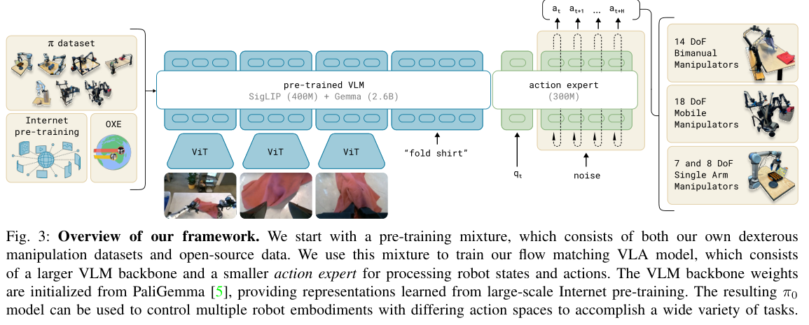

下图裁自 PDF p. 16 的 Table I，是全文对端到端 serving 最有价值的一张表。它把图像编码、观察前向、10 步动作前向和网络延迟分开报告。

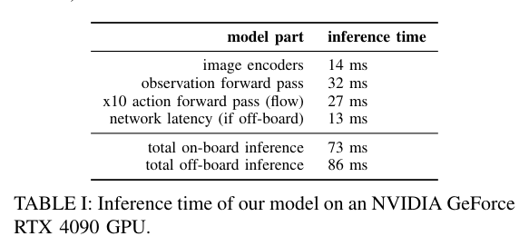

### 6.4 数据面

论文声称使用超过 10,000 小时机器人数据、7 种机器人配置和 68 个任务。自采数据约 903M 个时间步，其中约 106M 来自单臂、797M 来自双臂；预训练还混合 OXE、DROID、Bridge 等开放数据，开放数据约占训练混合的 9.1%。

异构数据的主要处理包括：

- 本体状态和动作统一到最大 18 维；
- 低维机器人补零；
- 缺失相机槽位做 mask；
- 以任务—机器人组合的 $n^{0.43}$ 权重进行次线性降权；
- 将数据划分为覆盖广泛行为的预训练集与高质量、策略一致的后训练集。

这些操作本质上是一个具身数据仓库/特征规范问题。模型无法直接接受维度不一致的机器人状态，系统必须保存：

- 每个动作维度的物理含义和单位；
- 机器人类型、夹具类型、相机位置和分辨率；
- 数据来源、任务定义和控制频率；
- 对补零维度的有效 mask；
- 动作归一化和反归一化参数。

论文没有给出数据存储格式、压缩率、读取吞吐和训练 dataloader 实现，因此不能直接据此估算数据湖带宽。

### 6.5 训练面

训练分为两个阶段：

1. **预训练：** 在大规模、跨机器人、覆盖多场景和多任务的数据上学习通用行为、恢复与纠错。
2. **后训练/微调：** 使用目标任务的高质量数据，使行为更熟练、更一致。

模型总参数约 3.3B，由约 3B 的 PaliGemma 骨干与约 300M 的 action expert 组成。实现上使用混合专家式权重：视觉语言 token 使用预训练骨干，机器人状态和动作 token 使用从零初始化的 action expert，并通过共享注意力交互。

对训练基础设施的直接影响：

- VLM 预训练权重与动作专家需要不同的更新策略；
- 动作 token 和视觉/语言 token 有不同的计算路径和激活模式；
- 混合任务/机器人数据要求 custom sampler 和权重控制；
- 预训练和后训练使用不同数据质量与分布，需要多阶段 checkpoint 管理和回滚；
- action expert 从零初始化，不能只加载 VLM 的单个统一 checkpoint。

论文正文没有给出完整的 GPU/TPU 数量、总训练时长和通信拓扑，故不能把 3.3B 参数量直接换算成训练成本。

### 6.6 推理面

π₀ 的推理分成三个主要阶段：

1. **图像编码：** 2 或 3 路 RGB 图像；
2. **观察前缀前向：** 视觉、语言和机器人状态的 token；
3. **动作后缀积分：** 10 次 flow matching 前向，从噪声积分到动作块。

原论文 Table I 的时间分解如下：

| 阶段 | RTX 4090 上的时间 |
| --- | ---: |
| 图像编码 | 14 ms |
| 观察前向前向 | 32 ms |
| 10 次动作前向（flow） | 27 ms |
| 网络延迟（离板服务） | 13 ms |
| 总板载推理 | 73 ms |
| 总离板推理 | 86 ms |

这里最容易误解的是“50 Hz”和“73 ms”。73 ms 是一次新动作块推理的本地耗时，可以满足约 14 Hz 的单次同步请求；论文以 50 Hz 执行动作块，是因为它一次生成 50 步动作，并在 50 Hz 机器人上执行 25 步后重新查询。也就是说：

- 动作执行频率可以高于每次完整模型调用的频率；
- 50 Hz 不是每秒执行 50 次完整的 3.3B 模型前向；
- 动作块内部的 0.5 秒为开环执行；
- 20 Hz 机器人每 0.8 秒执行 16 步后重规划。

### 6.7 缓存与批处理的系统含义

论文明确指出，在 10 步 flow 推理中，观察前缀 $o_t$ 的 attention keys/values 被缓存，每步只需要重新计算动作 token 的后缀。这与语言模型推理中的 prefix cache 类似：

- 图像、语言和本体状态是稳定前缀；
- 噪声动作是每个去噪步变化的动态后缀；
- 缓存减少重复前缀计算，但依旧需要 10 次动作专家前向；
- 缓存的生命周期止于下一次新观察，不能跨不同观测请求复用。

实现层面还应考虑：

- 每个机器人请求有不同的相机数量和 mask，batch 形状离散，影响 kernel 利用率；
- 多相机特征缓存占用显存，增加并发请求的显存压力；
- 动作块输出是 $H\times D$ 的连续张量，不是自回归 token，适合批量返回和下游执行；
- 若服务多个机器人，短 batch 可能浪费 GPU，大 batch 又会增加 p99 排队时间。

论文报告的是 RTX 4090 单请求时间分解，没有给出并发吞吐、batch scaling、功耗或多机器人调度曲线。

### 6.8 运行面

π₀ 选择直接执行动作块，不采用时间集成。动作块的执行时间由机器人的控制频率决定：

- 20 Hz 机器人执行 16 步，约 0.8 秒；
- 50 Hz 机器人执行 25 步，约 0.5 秒。

执行期间如果任务观测发生变化，模型不会每个周期都重新生成；这降低了计算压力，但也意味着：

- 必须保证动作块在硬件上的时间戳和序列完整；
- 网络或推理超时不能打乱动作执行顺序；
- 本轮块执行完毕前要准备好下一块，避免空档；
- 低层控制器要处理接触、限位和异常；
- 对移动机器人，Wi-Fi 网络延迟会直接进入端到端动作延迟。

板载 73 ms 与离板 86 ms 的差异说明，网络是独立的延迟项；真实施工还需要报告网络抖动、丢包和重连，而非只报告平均 RTT。

### 6.9 边界与 Infra 结论

π₀ 的开放问题包括数据最优配比、跨本体迁移条件、高成功率所需数据量，以及长期可靠性和安全验证。论文中部分复杂任务依赖任务后训练，部分语言任务还使用高层 VLM 子任务指令，因此要区分基础策略、微调策略和完整多阶段系统。

对 AI Infra，最值得复用的是：

- 明确的**异构数据规范**：最大维度补零、相机 mask、任务权重；
- 明确的**两阶段训练规范**：广度预训练 + 高质量后训练；
- 明确的**推理预算规范**：视觉编码、前缀前向、flow 后向、网络延迟分别计时；
- 将动作块作为高频控制与低频大模型推理之间的调度缓冲。

---

## 7. OpenVLA-OFT：并行解码与真实双臂部署

### 7.1 论文定位

**论文：** Moo Jin Kim, Chelsea Finn, Percy Liang, *Fine-Tuning Vision-Language-Action Models: Optimizing Speed and Success*, arXiv:2502.19645v2。

**本地文件：** [Kim 等 OFT 原始 PDF](<../Kim 等 - 2025 - Fine-Tuning Vision-Language-Action Models Optimizing Speed and Success/Kim 等 - 2025 - Fine-Tuning Vision-Language-Action Models Optimizing Speed and Success.pdf>)

这篇论文不是新造一个更大的基础模型，而是系统研究 VLA 微调时的动作生成策略、动作表示和目标函数，并把“速度”和“成功率”放在一起优化。它的 Infra 价值在于把自回归 VLA 的串行瓶颈具体化为可替换的解码、动作块和动作头设计。

### 7.2 原文关键段

自回归动作块的计算瓶颈：

> “However, OpenVLA’s autoregressive generation scheme makes action chunking impractical, as generating even a single-timestep action takes 0.33 seconds on an NVIDIA A100 GPU. For a chunk size of K timesteps and action dimensionality D, OpenVLA requires KD sequential decoder forward passes versus just D passes without chunking.”（PDF p. 3）

并行解码的目标：

> “Unlike autoregressive generation which requires sequential token prediction, parallel decoding enables all action tokens to be predicted simultaneously in a single forward pass.”（PDF p. 3）

最终微调配方：

> “Based on the demonstrated improvements in task performance, inference efficiency, and model input-output flexibility, we propose an Optimized Fine-Tuning (OFT) recipe for VLA adaptation that combines three key components: 1) parallel decoding with action chunking 2) continuous action representation 3) L1 regression objective.”（PDF p. 7）

真实 ALOHA 配置：

> “The ALOHA platform comprises two ViperX 300 S arms, three camera viewpoints (one top-down, two wrist-mounted), and robot state inputs (14-dimensional joint angles). It operates at 25 Hz (reduced from the original 50 Hz to enable faster training while still maintaining smooth robotic control), with actions representing target absolute joint angles.”（PDF p. 7）

训练配置：

> “We fine-tune OpenVLA using OFT+ on each task independently for 50-150K gradient steps (total batch size 32 with 8 A100/H100-80GB GPUs) with action chunk size K = 25. At inference time, we execute the full action chunk before requerying the model for the next chunk.”（PDF p. 8）

### 7.3 原论文设计决策图

下图裁自 PDF p. 3，左侧比较逐 token 自回归和单次并行生成，右侧比较离散 token 与连续动作表示。

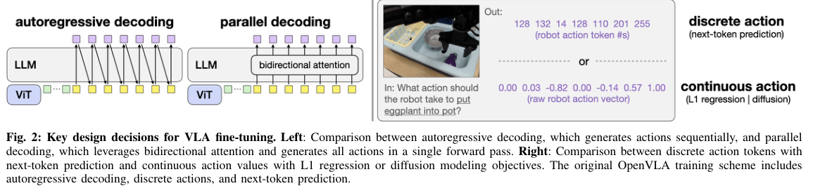

### 7.4 推理机制与效率表

原始 OpenVLA 的动作生成可以抽象为：

$$
\text{action tokens}
=t_1,t_2,\ldots,t_{KD},
$$

其中 $K$ 是动作块长度，$D$ 是每步动作维度。自回归需要 $KD$ 次串行解码；动作块越长，串行链越长。OFT 则让 $K\times D$ 个连续动作在同一个并行前向中产生，再用 L1 回归训练动作头。

PDF p. 10 的 Table III 给出真实 ALOHA 的推理效率测量，所有查询均处理三张 $224\times224$ 图像、14 维状态和任务文本。为了保留原表，下图直接给出原表区域：

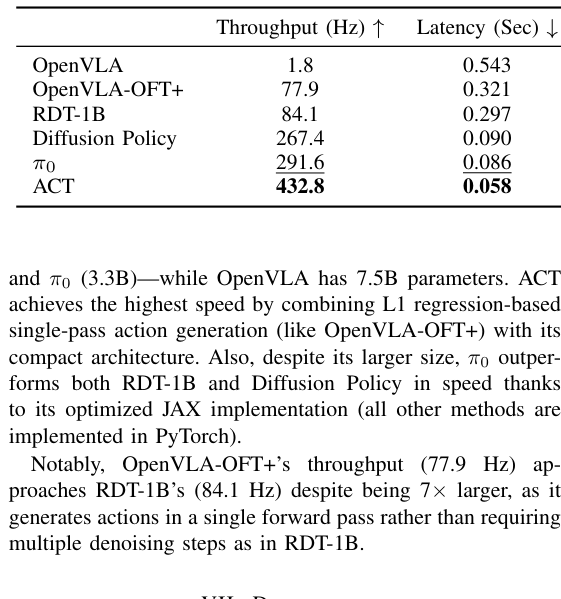

表中与本文直接相关的关键行是：

| 配置 | 吞吐 | 单次延迟 |
| --- | ---: | ---: |
| 原始 OpenVLA | 1.8 Hz | 0.543 s |
| OpenVLA-OFT+ | 77.9 Hz | 0.321 s |

这里的 77.9 Hz 是 action generation throughput，0.321 s 是单次请求延迟，不是 25 Hz 实际控制频率。真实 ALOHA 每执行完 $K=25$ 个动作才重新查询一次；以 25 Hz 执行，一个动作块覆盖约 1 秒。单次 0.321 s 可以藏在一个执行块内部，但若网络或多机器人排队把延迟推到 1 秒以上，就会出现动作空档。

### 7.5 数据面

ALOHA 真实实验使用：

- 两个 ViperX 300 S 机械臂；
- 一个顶视相机、两个腕部相机；
- 14 维关节状态；
- 14 维绝对关节目标；
- 25 Hz 控制；
- 每任务独立微调；
- 动作块长度 25。

四个任务及其训练/评估规模：

| 任务 | 训练示范数 | 评估次数 |
| --- | ---: | ---: |
| fold shorts | 20 | 10 |
| fold shirt | 30 | 10 |
| scoop X into bowl | 45 | 12 |
| put X into pot | 300 | 24 |

这说明“细调数据少”并不等于“系统成本低”。除了示范采集，还要处理 OpenVLA 预训练数据与 ALOHA 输入分布之间的差异：OpenVLA 预训练主要是单臂、单第三人称相机、低频率、相对末端动作；ALOHA 是双臂、三相机、25 Hz、绝对关节目标。

### 7.6 训练面

OFT+ 的主要训练资源是：

- 基础模型约 7B；
- 8 张 A100/H100 80 GB；
- 总 batch 32；
- 每任务 50K–150K 梯度步；
- 动作块 $K=25$；
- LoRA 微调；
- 连续动作 MLP 头；
- FiLM 语言条件调制。

论文的体系变化可以看成“减少串行 token 生成 + 增加并行动作输出”。它不是简单地扩大 GPU，而是改变了训练和推理的计算图：

1. 输入侧增加多相机、机器人状态和文本；
2. 输出侧一次性生成 $K\times D$ 连续动作；
3. 语言特征通过 FiLM 注入视觉特征；
4. L1 目标直接回归动作块，避免扩散或 flow 的多次采样。

论文没有给出完整的预训练成本、每任务的训练墙钟和显存峰值，只给出了任务无关的训练步骤和硬件数量。

### 7.7 运行面与输入输出弹性

OFT 的一个重要工程结果是：并行解码释放出的计算余量可以用来处理更多输入。论文把腕部相机加入后，视觉 patch 数从 256 增加到 512，仍保持约 71.4 Hz 吞吐和 0.112 秒延迟。

对部署系统的启示：

- 输出动作块的长度应与策略频率一起选，而不是单独追求最大 $K$；
- 输入相机数增加会拉长视觉前缀，但并行动作头仍能把输出侧成本压住；
- 执行动作块期间可以并行准备下一次推理请求；
- 需要处理“模型生成完成但执行队列还没消费完”或“执行完但模型还没返回”的双缓冲情况；
- 以 25 Hz 执行 25 步动作块时，重规划周期约 1 秒，任何 p99 延迟超过该周期都会破坏闭环节奏。

### 7.8 失败边界与训练—推理差异

作者明确把 L1 回归的多模态局限列为未来问题：L1 更接近学习示范动作的中位模式，在存在多个同样合理动作分支时可能不够灵活；扩散模型能表达多模态，但推理更重，也可能过拟合肥胖的次优模式。

这给出了一个重要的 Infra 判断：**动作表示的生成能力与 serving 成本不是两个独立问题**。更复杂的生成目标需要更多采样步数和更长的 serving 链路；更简单的回归目标可能牺牲模式表达。系统设计必须同时报告速度和成功率，而不是只看其一。

### 7.9 Infra 要点

1. **并行解码是降低串行延迟的核心。** 把动作块从 $KD$ 次顺序解码变成一个并行动作头，直接缩短关键路径。
2. **吞吐和单请求延迟必须分开。** 77.9 Hz 的批量/流式吞吐不等同于每个机器人都能在 77.9 Hz 得到响应；实际控制频率还受执行块、并发排队和网络影响。
3. **动作块是运行时契约。** 执行块长度决定了模型服务必须在该周期内返回下一次预测，任何排队或抖动都应纳入安全设计。
4. **多模态输入带来输入侧成本。** 增加腕部相机会增加视觉 token；并行输出能腾出预算，但不能消除视觉编码本身的成本。

---

## 8. Infra 复核清单与术语

这一节不是论文间比较，而是阅读完成后的自检工具。任一具身策略落地时，都可以用同一张表记录系统边界。

### 8.1 端到端时间预算

建议至少拆成以下阶段，并以时间戳记录：

| 阶段 | 需要记录的内容 |
| --- | --- |
| 采集 | 曝光时间、相机帧率、丢帧、不同相机间时间差 |
| 预处理 | resize、颜色空间、归一化、tokenization、动作归一化 |
| 模型 | 图像编码、观测前向、动作生成、采样步数/NFE |
| 服务 | batch 排队、KV/cache 占用、模型加载、并发数 |
| 传输 | 网络 RTT、重传、时钟偏差、动作序列完整性 |
| 运行 | 动作块执行周期、重规划周期、底层控制频率、超时 fallback |

只报告“模型推理 ms”不足以判断系统能否闭环，因为相机采集、网络、动作块缓存和底层执行都可能成为关键路径。

### 8.2 指标

建议区分：

- **吞吐：** 单位时间能生成多少动作步或完成多少请求；
- **首动作延迟：** 从观测可用到第一段动作可执行的延迟；
- **请求延迟：** 生成完整动作块所需时间；
- **控制周期：** 执行器或底层控制器实际运行的频率；
- **p99/抖动：** 对机器人安全更重要的尾部延迟和周期波动；
- **显存峰值：** 并发数、相机数和缓存长度下的峰值，而非仅模型静态权重；
- **成功率：** 与延迟在同一硬件、同一动作版本下测量；
- **动作质量：** 位置误差、速度/加速度约束、接触稳定性和重规划次数。

### 8.3 常见混淆

| 容易混淆的说法 | 更准确的理解 |
| --- | --- |
| 50 Hz 模型 | 可能是控制/动作执行频率，不一定是完整模型每秒前向 50 次。 |
| 动作块降低了计算量 | 它降低单位动作的平均重规划次数，但一次推理仍要生成整块；若仍每步查询，总计算未必下降。 |
| 位置控制提供了力 | 位置目标通过伺服误差间接产生力，真实接触力还依赖控制器增益、物体柔顺和动力学。 |
| 端到端 0.1 秒 | 必须确认是否包含相机采集、预处理、网络和动作后处理。 |
| 云端大模型可服务多机器人 | 还需要知道并发、排队、p99、故障恢复和动作时序。 |
| 量化减少显存就能实时 | 还要验证量化后成功率、动作误差、采样速度和并发行为。 |

### 8.4 术语速查

| 术语 | 含义 |
| --- | --- |
| Action chunk | 一次预测的多步未来动作；执行其中一部分后重新规划。 |
| Receding horizon | 预测较长动作序列，只执行前面一小段，再基于新观察重算。 |
| NFE | Number of Function Evaluations，扩散/flow/ODE 求解时的函数评估次数。 |
| Prefix cache / KV cache | 复用固定观测前缀的 attention keys/values，只重算新的动作 token。 |
| End-effector action | 输出末端执行器的位移/位姿/夹爪状态，需要底层运动学或控制器转换。 |
| Joint action | 直接输出各关节目标，通常与具体机器人运动学绑定。 |
| Throughput | 单位时间处理多少动作或请求，不等于单机器人响应延迟。 |
| p99 latency | 99% 请求不超过的延迟；对闭环控制通常比平均值更有意义。 |

### 8.5 建议的阅读笔记模板

每读完一篇论文，建议留下以下记录：

```text
论文：
任务/机器人：
输入：
动作空间与动作块：
数据规模与采集频率：
模型规模：
训练硬件/时长/批大小：
推理硬件/框架/精度：
是否缓存：
完整延迟拆分：
控制/重规划频率：
并发与批处理信息：
精度或成功率：
未报告的关键 Infra 指标：
```

这份模板可以防止把论文中的单个时间数字误当成端到端性能，也能帮助后续做复现实验、容量规划和硬件选型。

## 资料来源

以下链接指向本目录中的原始 PDF，便于回到正文和附录核对引文、表格与页码。

1. [Zhao 等，ALOHA / ACT（2023）](<../Zhao 等 - 2023 - Learning Fine-Grained Bimanual Manipulation with Low-Cost Hardware/Zhao 等 - 2023 - Learning Fine-Grained Bimanual Manipulation with Low-Cost Hardware.pdf>)
2. [Chi 等，Diffusion Policy（2024 arXiv v5）](<../Chi 等 - 2024 - Diffusion Policy Visuomotor Policy Learning via Action Diffusion/Chi 等 - 2024 - Diffusion Policy Visuomotor Policy Learning via Action Diffusion.pdf>)
3. [Lipman 等，Flow Matching for Generative Modeling（2023）](<../Lipman 等 - 2023 - Flow Matching for Generative Modeling/Lipman 等 - 2023 - Flow Matching for Generative Modeling.pdf>)
4. [Brohan 等，RT-2（2023）](<../Brohan 等 - 2023 - RT-2 Vision-Language-Action Models Transfer Web Knowledge to Robotic Control/Brohan 等 - 2023 - RT-2 Vision-Language-Action Models Transfer Web Knowledge to Robotic Control.pdf>)
5. [Kim 等，OpenVLA（2024）](<../Kim 等 - 2024 - OpenVLA An Open-Source Vision-Language-Action Model/Kim 等 - 2024 - OpenVLA An Open-Source Vision-Language-Action Model.pdf>)
6. [Black 等，π₀（本地 arXiv v4，2026-01-08）](<../Black 等 - 2026 - $π_0$ A Vision-Language-Action Flow Model for General Robot Control/Black 等 - 2026 - $π_0$ A Vision-Language-Action Flow Model for General Robot Control.pdf>)
7. [Kim 等，Fine-Tuning VLA: Optimizing Speed and Success（2025 arXiv v2）](<../Kim 等 - 2025 - Fine-Tuning Vision-Language-Action Models Optimizing Speed and Success/Kim 等 - 2025 - Fine-Tuning Vision-Language-Action Models Optimizing Speed and Success.pdf>)

论文中的图表裁剪仅用于本地学习与阅读笔记；若需对外发布，应回到原始出版版本核对图注、版权和最终排版。
